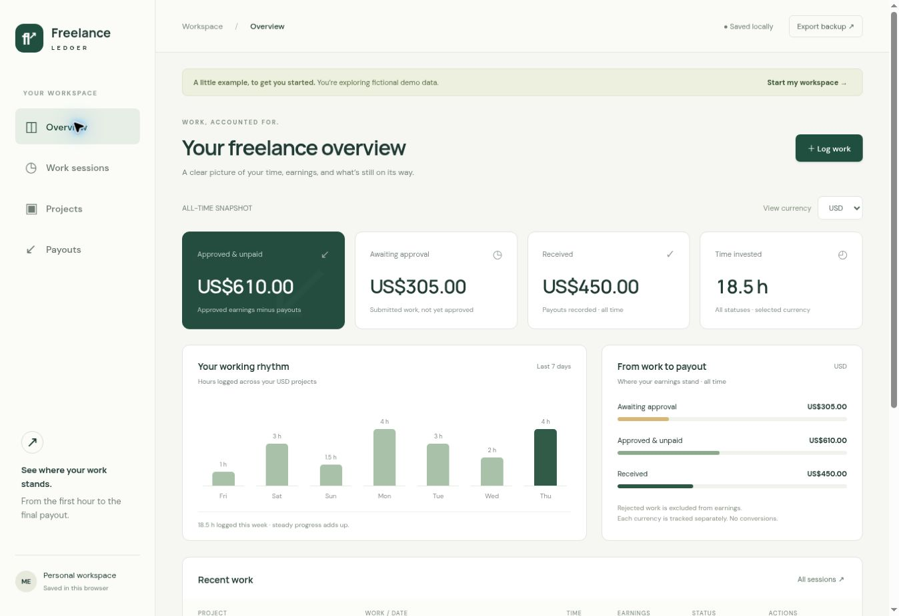

# Freelance Ledger

A personal app for tracking freelance work from logged hours to approval and payout.



## The problem

When working across freelance platforms, a headline hourly rate does not tell you how much money is actually on its way. Sessions may still be awaiting approval, rejected work may be unpaid, and payouts can arrive in parts. Freelance Ledger keeps these stages visible without mixing currencies.

## Status: working prototype (v0.1)

This is an early personal project initiated by Andrei Doman and implemented with AI assistance. It is not an established commercial product. Demo records are fictional. No affiliation with any freelance platform is implied.

### Working features

- Create and edit projects with an hourly rate and currency (EUR, USD, GBP).
- Log and edit work sessions with dates, notes, and approval status.
- Preserve each session's rate when the project rate changes.
- Approve submitted work; keep rejected sessions in time totals but out of earnings.
- Record partial payouts against a project's approved balance.
- Prevent payouts and retrospective session changes from exceeding approved earnings.
- Display per-currency summaries and a seven-day activity chart.
- Filter sessions by project and approval status; search notes.
- Separate fictional demo data from personal records.
- Export and restore validated JSON backups.
- Responsive layout with browser-local persistence.

## Run locally

No installation or build is required. Serve the `dist` directory with any local static HTTP server, for example:

```sh
python3 -m http.server 8000 --directory dist
```

Open http://localhost:8000. Opening the HTML directly as a file is not supported because the app uses JavaScript modules.

Optional checks, using a current Node.js installation:

```sh
node --check dist/app.js
node --test tests/*.test.js
```

## Structure

- `dist/index.html`: page shell and modal form.
- `dist/style.css`: responsive visual design.
- `dist/app.js`: views, forms, persistence and user interaction.
- `dist/model.js`: earnings calculations, validation and fictional demo data.
- `tests/model.test.js`: regression tests for financial invariants.
- `docs/PRODUCT.md`: decisions, limitations and development backlog.

## Calculation rules

Time is rounded to whole minutes. Rates and monetary amounts use integer cents. Each session's gross earnings are rounded to the nearest cent: `round(minutes × hourlyRateCents / 60)`.

- Awaiting approval = submitted session earnings.
- Approved earnings = approved session earnings.
- Approved & unpaid = approved earnings minus recorded payouts.
- Received = recorded gross payout amounts.
- Time invested includes submitted, approved and rejected sessions.

Currencies are never added together or automatically converted. Payouts reconcile at the project level rather than against individual sessions. Enter gross amounts settled in the original project currency; fees, deductions and foreign exchange are outside this initial version.

## Data and privacy

Records are stored in localStorage in the current browser and origin. There is no backend database or cross-device sync. Clearing browser data can remove records. Export JSON backups regularly. The hosted private Site has an access gate, but browser storage itself is not encrypted by this app. Use fictional data for public demos and AI evaluation sessions. The app does not call platform APIs. Google Fonts is used for typography with local fallback fonts.

The `.openai/hosting.json` file is hosting-specific and is not needed for local use. No runtime secrets or personal work records belong in this repository.
